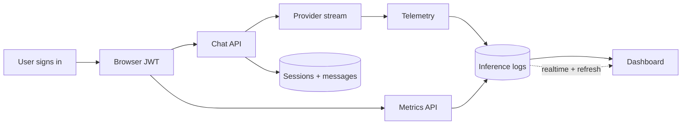
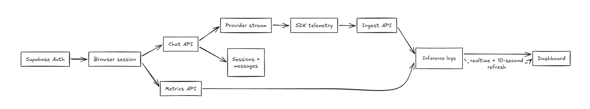
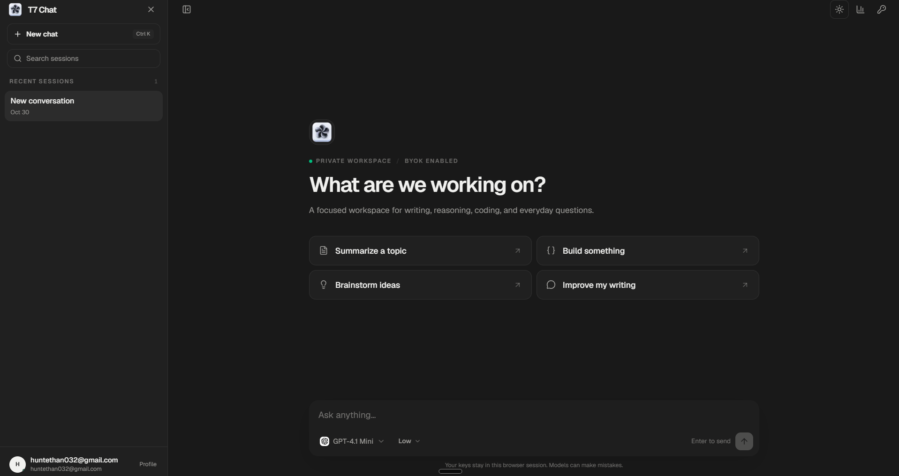

# How It Worked

T7 Chat keeps the browser fast and puts identity, persistence, provider calls, and telemetry behind server routes.

## Architecture

## Request flow

1. Supabase Auth signs the user in. The browser keeps the JWT and sends it with authenticated requests.
2. `POST /api/chat` validates the model, provider, key, and session ID.
3. The server saves the user message, calls the provider, and streams the response over SSE.
4. The completed assistant message is saved to the same session.
5. The SDK sends latency, token estimates, status, and redacted previews to `POST /api/ingest`.
6. The dashboard reads the user’s records through `GET /api/metrics`.

## Data and security

- Sessions, messages, and logs belong to a `user_id`.
- Server routes resolve the user from the JWT before reading or writing data.
- Database policies protect direct reads and writes for the authenticated user.
- The service-role key stays on the server. It is never exposed to the browser.
- Authenticated provider keys are encrypted and account-scoped. Guest keys stay in the browser session.

## Sidebar and dashboard behavior

- The sidebar merges local and server sessions so a refresh cannot discard browser-only threads.
- Missing local sessions are backfilled to Supabase after authentication.
- Dashboard reads use `no-store`; realtime inserts are combined with a short refresh fallback.
- Failed telemetry writes are recorded in `failed_logs` when the database is available.

## Design questions

### Why keep the server as the trust boundary?

The browser should feel immediate, but it should not decide which account owns a session or metric. Server routes apply the same ownership rule to chat, sessions, keys, and analytics.

### How would I scale this?

Move telemetry to a queue, paginate or time-limit dashboard queries, keep realtime subscriptions user-scoped, and archive older logs.

### What could improve?

Use provider-reported token usage instead of estimates, add durable telemetry retries with idempotency, and run authenticated end-to-end tests against a disposable Supabase project.

### Why use both realtime and refresh?

Realtime is responsive but not a delivery guarantee. A short no-store refresh is a simple fallback that keeps the dashboard correct.

## Production checklist

- Apply the SQL migrations in filename order.
- Keep service-role, encryption, and database secrets out of source control.
- Enable Supabase realtime for `inference_logs` if live dashboard inserts are required.

## Interface reference

