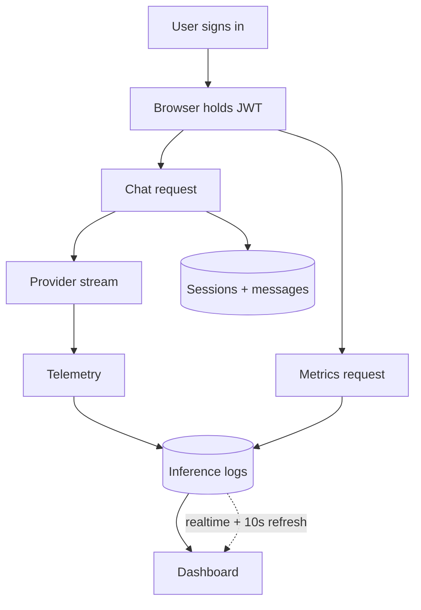

# How It Worked

The browser handles interaction. The server handles identity, persistence, provider calls, and telemetry.

## Key decisions

- **Why this split?** The browser stays responsive while the server keeps user data and provider calls behind authentication.
- **How would I scale this?** Move telemetry writes to a queue, paginate dashboard reads, and keep realtime updates scoped to one user.
- **What could improve?** Add durable retries for telemetry and stronger end-to-end tests against a real Supabase project.
- **Why the refresh fallback?** Realtime is fast, but the short refresh catches missed events without serving stale data.
