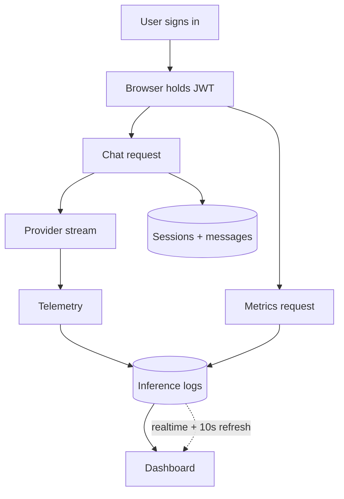

# How It Worked

The browser handles interaction. The server handles identity, persistence, provider calls, and telemetry.

## Design questions

### Why this split?

Keep the UI responsive while the server controls user data and provider calls.

### How would I scale this?

Queue telemetry, paginate metrics, and scope realtime updates by user.

### What could improve?

Add durable telemetry retries and end-to-end tests against Supabase.

### Why the refresh fallback?

Realtime is fast, but the short refresh catches missed events without serving stale data.
