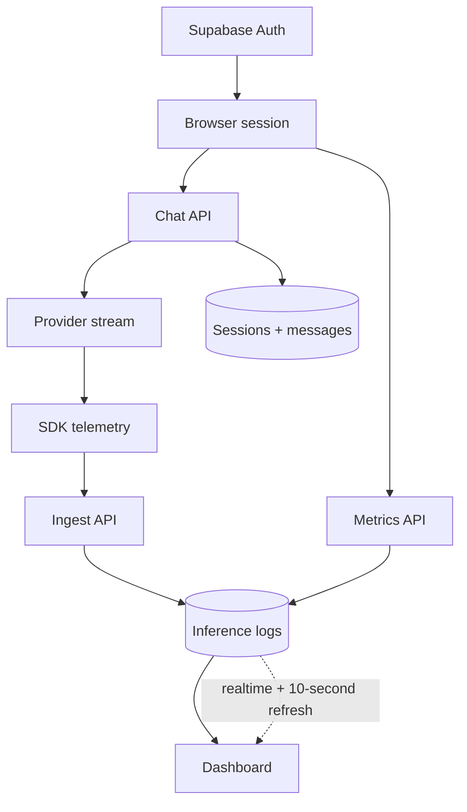

# How It Worked

This document explains the main production decisions behind T7 Chat. The goal was to keep the chat interface fast while keeping identity, persistence, provider requests, and analytics under server control.

## Architecture

## Request lifecycle

1. A user signs in with Supabase Auth. The browser keeps the current access token and forwards it with authenticated requests.
2. The chat client sends the selected model, provider, session ID, messages, and provider key to `POST /api/chat`.
3. The server validates the request and provider key, resolves the user from the JWT, then creates or updates the user-owned session.
4. The selected provider streams tokens back over SSE. The browser renders each token as it arrives, while the completed user and assistant messages are persisted.
5. The SDK records latency, estimated token counts, status, and redacted previews. It forwards that record to `POST /api/ingest` with the same authorization context.
6. The dashboard loads the user’s logs through `GET /api/metrics`. Supabase realtime adds new rows quickly, and a short refresh catches events that were missed.

## Persistence and security

Sessions and messages are owned by `user_id`. Server routes resolve the user before reading or writing account data, and database policies restrict direct reads to that same user. The service-role key is used only on the server; it is never sent to the browser.

Provider keys follow two paths. Authenticated keys are encrypted before they are stored and are scoped to the account. Guest keys remain in the browser session. Provider keys are never committed to the repository or placed in public environment variables.

The sidebar keeps a local copy for immediate UI updates, but authenticated users are refreshed from the server. Refreshes are debounced and ordered so the many browser updates produced during streaming cannot let an older response overwrite a newer session list.

## Telemetry and dashboard behavior

Inference logs are intentionally small. They contain operational fields such as provider, model, latency, token estimates, status, and short redacted previews. The dashboard reads only the current user’s records and displays the latest requests, model values, latency, token totals, and error rate.

The metrics and session endpoints use `Cache-Control: private, no-store`, and browser fetches also disable caching. This avoids showing an old dashboard after a new inference. Realtime is used for responsiveness, not as the only source of truth; the refresh fallback makes the view recover when a realtime event is delayed or dropped.

Database writes that cannot be stored are recorded in `failed_logs` so ingestion problems can be investigated without exposing them to the user interface.

## Design questions

### Why make the server the trust boundary?

The browser needs to feel immediate, but it should not decide which account owns a session or analytics row. Keeping those checks in the server routes makes the ownership rule consistent for chat, sessions, provider keys, and metrics.

### How would I scale this?

The first step would be to move telemetry ingestion to a queue so provider responses do not depend on a database write completing immediately. Dashboard queries should become paginated or time-windowed instead of reading a fixed recent batch. Realtime subscriptions should remain filtered by user, and older logs can be archived separately.

### What could improve?

Provider token usage should replace the current estimates wherever an API returns usage data. Telemetry delivery should have durable retries and an idempotency key. The next test layer should run authenticated chat, session persistence, ingestion, and dashboard reads against a disposable Supabase project.

### Why use both realtime and refresh?

Realtime gives the dashboard a responsive feel, but it is not a durable delivery guarantee. A short no-store refresh is simple, cheap at this scale, and repairs the view without introducing a second state store.

## Production checklist

- Apply the SQL migrations in filename order, including the observability hardening migration.
- Keep the service-role and encryption secrets server-side.
- Configure Supabase Email/Password authentication and enable realtime for `inference_logs` if live inserts are required.
- Monitor `failed_logs` and provider error rates before increasing traffic.
- Replace the fixed recent-log window with pagination before the dataset becomes large.
